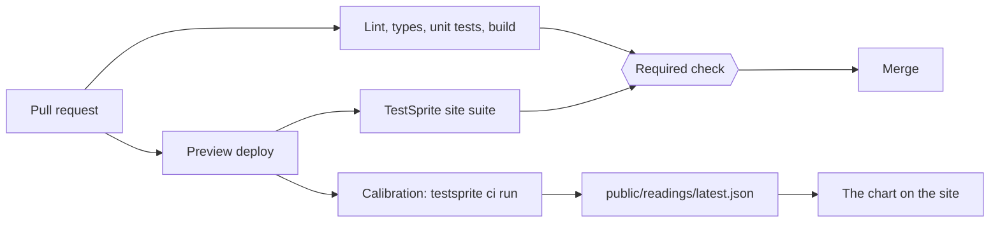

# Eye Chart

An eye exam for TestSprite's AI tester. We built a chart of real UI widgets ("letters"), each with a twin that works and a twin that is visibly broken, ran TestSprite's cloud agent on every twin, and show which ones it read right and which it misread.

Every misread letter ships a "lens", a small code change, and the site shows the reading again with the lens on.

## Live URL

[X: public URL of the deployed chart]

## Check it yourself in 60 seconds

1. Open the live URL. The chart shows every letter with its reading.
2. Pick a letter. Open its twins at `#/l/<letter-id>/works` and `#/l/<letter-id>/broken`. Each twin is the widget alone on a plain page. Use it with your own hands and decide what is true.
3. Compare your call with the reading. The chart shows TestSprite's own stated reason for each verdict, word for word.
4. Open `/readings/latest.json`. It lists every run with its run id, verdict and reason. Nothing on the chart is typed in by hand.
5. Open a letter that was misread, then its `#/l/<letter-id>/lens` twin. That is the same widget after the lens. The chart shows the reading taken with the lens on.
6. Open the pull request list on GitHub. The TestSprite check is on every PR.

## How the checks run on their own

Two TestSprite projects, two jobs.

| Project | What it tests | When it runs | Holds the merge? |
|---|---|---|---|
| Site suite | The chart site itself: the chart, routing, the twin pages, the reading panels | On every PR, through the TestSprite GitHub App, against the PR's preview | Yes. It is a required check. |
| Calibration | The twins: every letter, works, broken and lens | On every PR, by a GitHub Action that runs `testsprite ci run` against the preview | No. It re-examines the agent and commits fresh readings. |

The site suite protects the site. The calibration protects the claim: if TestSprite's agent changes, the chart changes, and the diff shows it.

Local checks (lint, typecheck, unit tests, build) also run on every PR in `.github/workflows/ci.yml`.

## What the suite covers

- [X] tests in the site suite: [X] UI, [X] API. Last run on `main`: [X] of [X] passing.
- The chart renders every letter in registry order, with its reading or "not read yet".
- Every twin route renders its widget alone and responds to the real interaction.
- The reading panel shows the verbatim reason, the run id and the date from `latest.json`.
- Reduced motion shows a flat chart with the same content.
- [X: anything else the portal suite really contains]

## The letters

Row 1 is easiest for an AI tester. Higher rows add motion, hover-only controls, shadow DOM, canvas, WebGL and real-time play.

| Row | Letter | Trap | Works twin | Broken twin | Read correctly? | Lens | With lens |
|---|---|---|---|---|---|---|---|
| [X] | [X] | [X] | [X] | [X] | [X] | [X] | [X] |

A reading is correct when the verdict matches the truth: a working widget passes, a broken one fails. "Blocked" runs are counted on their own line.

## How it fits together



- `src/letters/` holds the twins and the letter registry.
- `public/readings/` holds the readings, one dated file per run and `latest.json`.
- `calibration/` holds the calibration project's setup.
- `.github/workflows/` holds the CI and calibration workflows.

## Run locally

Node 20.19 or newer (`.nvmrc` says 22).

```bash
npm ci
npm run dev
```

Checks:

```bash
npm run lint
npm run typecheck
npm test
npm run build
```

To take a calibration reading yourself you need a TestSprite account and an API key. Set `TESTSPRITE_API_KEY` and `TESTSPRITE_PROJECT_ID` in your shell or as repository secrets, then:

```bash
npm i -g @testsprite/testsprite-cli@0.15.0
testsprite ci run --target-url <your deployed url>
```

No key or secret is stored in this repo.

## License

MIT. See `LICENSE`.
